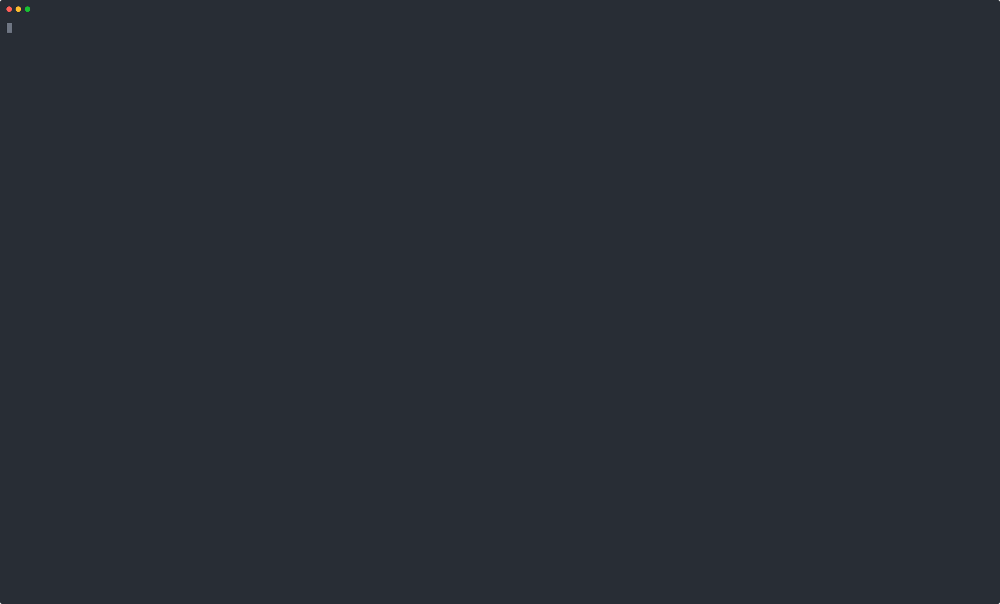
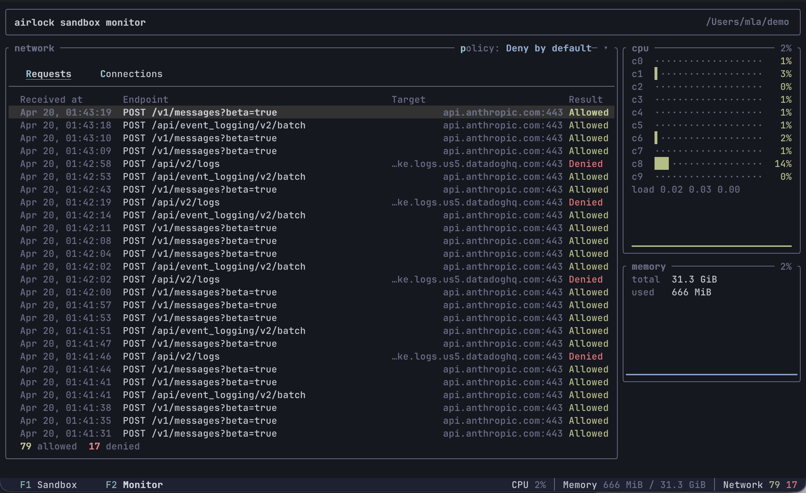

<p align="center">
  
</p>
<p align="center">
   <a href="https://milankinen.github.io/airlock"></a>
   <a href="https://github.com/milankinen/airlock/actions/workflows/ci.yml"></a>
   <a href="https://github.com/milankinen/airlock/releases/latest"></a>
</p>

---

Let AI agents (or any untrusted binary) roam freely inside a lightweight
sandbox VM that boots in seconds, has scriptable network control, and can run
any Linux-based OCI image. A single self-contained, daemonless binary — no
Docker required. Works on both macOS and Linux.



## Features

- **Configuration as code** — share sandbox setup with your team via a single TOML file.
- **Full network control** — allow or deny connections and individual HTTP
  requests, inject API keys with Lua-scriptable middleware, and inspect VM
  traffic in real time.
- **Packs** — set up Claude Code, OpenAI Codex, GitHub Copilot CLI and common
  tools (Docker, Node.js, Python, Rust, ...) with secure defaults in one click.
  Agent sign-ins go through the host, so your real tokens never enter the sandbox.
- **File & directory mounts** — share project files with the agent and nothing more.
- **Host port & socket forwarding** — reach the host's PostgreSQL, Redis, or Docker.
- **Agent hook integration** — surface network denials back to the agent so it
  sees *why* a tool failed and can stop to ask instead of retrying blindly.

## Quick start

> [!NOTE]
> This quick start uses Claude Code as the example, but airlock itself is
> agent-agnostic. See the other
> [agent packs](https://milankinen.github.io/airlock/packs/agents.html) for
> your favourite agent's setup.

### 1. Install `airlock`

The GitHub [releases](https://github.com/milankinen/airlock/releases) page
has prebuilt binaries. Download the latest one for the current user:

```bash
$ curl -fsSL https://github.com/milankinen/airlock/releases/latest/download/install.sh | sh

# The installer places the airlock binary under ~/.local/bin, so add
# that to your PATH to make it available.
$ export PATH=$PATH:~/.local/bin
```

### 2. Create your first sandbox

Navigate to your project directory and run `airlock start`. On the first
launch, airlock opens a setup wizard for the sandbox. Select the `claude`
agent and, optionally, the tools your project needs. If you want to share
the sandbox configuration with your teammates, also select
`Create airlock.toml`. Then choose `start`.

```
$ airlock start

   ▗    ▜       ▌
▝▀▖▄ ▙▀▖▐ ▞▀▖▞▀▖▌▗▘
▞▀▌▐ ▌  ▐ ▌ ▌▌ ▖▛▚
▝▀▘▀▘▘   ▘▝▀ ▝▀ ▘ ▘

Base image
  ◉ alpine
    • allow packages: yes
  ○ debian
Coding agents
  ■ claude
    • acp support: no
  □ codex
  □ copilot
Tools
  □ docker
  □ git
  □ mise
  □ nodejs
  □ python
  □ rust
Capabilities
  ■ clipboard: copy
  □ clipboard: paste
Config
  □ Create airlock.toml

←→ choose · enter confirm
« start · abort »
```

### 3. Start Claude Code and log in

When the setup is complete, your terminal is inside the sandbox, in your
project directory, with `claude` installed. Start Claude Code as usual:

```bash
$ claude --dangerously-skip-permissions
```

The sandbox is isolated from your host machine, so you need to log in
first. Type `/login` in Claude Code. The login page opens in your
default browser on the host, and once you log in there, the sandbox is
logged in as well.

Don't worry: your real tokens never leave the host. Airlock handles the
browser and network coordination, so the sandbox only ever receives
placeholder tokens. The login is shared between sandboxes, so you only
need to log in once.

That's it, you're good to go. Happy vibe coding!

### 4. Start with the monitor dashboard

If you want to see what's actually happening inside the sandbox, start
airlock with the
[monitor dashboard](https://milankinen.github.io/airlock/usage/monitor.html).
It lets you inspect the network traffic and change the network policy live,
for example to briefly allow all traffic while tools install:

```bash
$ airlock start --monitor
```



Interested? See the [user manual](https://milankinen.github.io/airlock)
for the full details.

## License

### Source code

All Rust source code in this repository is dual-licensed under **MIT OR Apache-2.0**
at your option, except [initramfs](app/vm-initramfs) and [kernel](app/vm-kernel)
that are licensed under **GPLv2** (deriving from Linux license).

### Pre-built binaries

Two variants are available on the [GitHub releases](https://github.com/milankinen/airlock/releases) page:

* **Bundled** (default, installed by `install.sh`) — includes an
  airlock-compatible Linux VM (kernel and initramfs). The bundled VM component
  is GPLv2; the airlock binary itself remains MIT OR Apache-2.0.
* **Distroless** (`install.sh --distroless`) — does not bundle any kernel or
  initramfs. Licensed entirely under MIT OR Apache-2.0.

When using the distroless build, you must supply your own kernel and initramfs
with the capabilities required by the `airlockd` supervisor.

## Similar tools

* [Microsandbox](https://github.com/microsandbox/microsandbox)
* [Docker Sandboxes](https://docs.docker.com/ai/sandboxes/)
* [OpenShell](https://github.com/NVIDIA/OpenShell)
